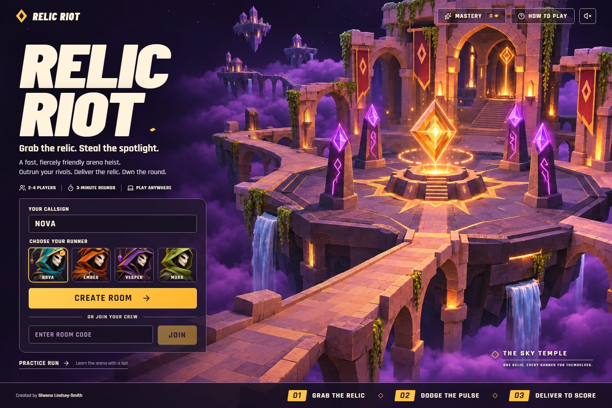
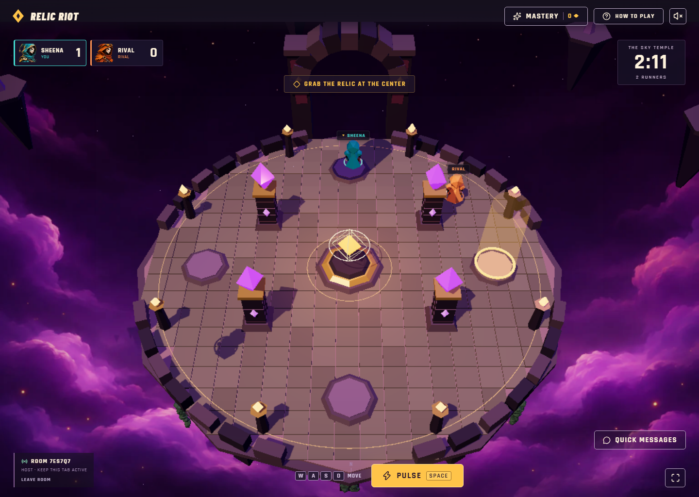

# RELIC RIOT

**Grab the relic. Steal the spotlight.**

An original, responsive 3D online multiplayer arena game created by **Sheena Lindsey-Smith** for Handshake's Create a Multiplayer Game mission.

**[Play RELIC RIOT](https://icandi40.github.io/relic-riot/)** · [Source](https://github.com/Icandi40/relic-riot)



## Play

1. Open the live site on two or more devices.
2. Choose a callsign and runner. One player selects **Create Room**.
3. Share **Copy Invite**, or send the six-character room code.
4. Everyone selects **I'm Ready**; the host selects **Start the Riot**.
5. Run into the amber relic. Carry it to the active shrine to score. Pulse nearby rivals to knock it loose. Highest points after three minutes wins; tied leaders share a draw. Classic deliveries earn 1 point. The host can enable **Relic Surge** before starting: deliveries in the final 30 seconds earn 2 points.

**Desktop:** WASD or arrows to move; Space to pulse. A connected gamepad's left stick and first button are supported. **Phone/tablet:** left joystick and right pulse button. Sound is optional and starts only after interaction. **Practice Run** is explicitly a separate mode with the ECHO bot.

## What makes it a multiplayer game

- 2–4 people join from separate devices through internet signaling and encrypted WebRTC data channels.
- One authoritative host simulation validates movement, cooldowns, pickups, scoring and match state. Guests send inputs, never scores or positions.
- Lobby readiness, countdown, snapshots, scoreboards and results are shared. Runners get distinct colors automatically.
- Inputs expire if a stream stops. A departed guest is removed; if only one remains, the room returns to the lobby. Host loss gives the guest an actionable error.
- Highest score, ties and rematches are implemented.

## Make every riot count

- **Round recap:** actual deliveries, steals, pulses landed, accuracy, time carrying and first-delivery time. Positive, untied statistics earn descriptive round awards.
- **Mastery:** five cumulative challenges unlock progressively harder tiers and award virtual Relic Shards. Completed online rounds award 20 shards, +5 per delivery and +25 for a sole win. Practice and abandoned rounds award none.
- **Wardrobe:** earn a Gilded cloak and mask, Starlight trail, or Royal crown and nameplate. These are rendered in 3D and never change movement, abilities or scoring. Equipped looks apply to the next room or practice run.
- **Quick messages:** five presets across the lobby, arena and recap. Sender identity is bound to the connection; messages are rate limited and kept in a small recent history.
- **Relic Surge:** opt-in final-30-second double points, shared countdown warning, warm shrine effects and an explicit HUD. Changing the option resets everyone's readiness.

Career progress is **saved in this browser on this device**. No account or cross-device synchronization is claimed. Clearing browser data resets progress. Shards have no cash value and cannot be purchased with money.

## Run locally

Use Node.js 22.12+ or a current supported Node release.

```sh
npm ci
npm run dev
```

Open the URL Vite prints. Other devices on the same LAN can open the printed network URL. Internet games use the deployed HTTPS site.

```sh
npm test          # deterministic simulation, rewards and progression tests
npm run build    # TypeScript and production bundle
npm run preview  # serve the production build locally
```

For browser integration tests:

```sh
npx playwright install chromium
npm run test:e2e
```

An existing Chromium executable can be selected with `PLAYWRIGHT_CHROMIUM_EXECUTABLE`. `GAME_URL` points the same tests at a deployed site. The tests create independent browser contexts, use real internet signaling, drive an actual pickup and delivery with keyboard input, verify the score on both clients, let the real three-minute clock finish, ready a rematch, and verify host-disconnect recovery. Browser rendering, mobile pointer controls and career transaction tests also run. The online suite takes several minutes. Browser emulation is not a physical-device test.

## Architecture

| Layer        | Implementation                                                                                                   |
| ------------ | ---------------------------------------------------------------------------------------------------------------- |
| Interface    | React, TypeScript, semantic HTML, responsive CSS, Lucide icons                                                   |
| 3D rendering | Three.js, original procedural temple and characters, real shadows, selective bloom, instanced stones and foliage |
| Simulation   | Fixed maximum movement step, wall-clock match timers, bounded inputs, host-owned state                           |
| Transport    | PeerJS cloud signaling and WebRTC data channels                                                                  |
| Audio        | Small synthesized Web Audio cues, user-controlled                                                                |
| Assets       | Original generated temple artwork, cloudscape, runner portraits; optimized WebP; locally bundled fonts           |
| Delivery     | Static Vite build; GitHub Pages deployment workflow                                                              |

See [DESIGN.md](DESIGN.md) for the locked visual direction and deliberate 3D adaptation, and [docs/ARCHITECTURE.md](docs/ARCHITECTURE.md) for engineering decisions.

## Hosting and connection boundaries

This release has **no paid model API, database or application server**. The host's browser runs each match, so **the host must keep the game tab open and active**. Leaving closes their room; host migration is outside this release. Use private invites rather than public matchmaking.

PeerJS's public signaling service and its library-default STUN/TURN endpoints are third-party dependencies, without an application-controlled availability guarantee. No private TURN relay is provisioned. Restrictive corporate networks or unavailable relay services can block connections; the interface explains recovery options. An application-controlled signaling/relay deployment or dedicated authoritative game server is the next infrastructure improvement.

The host has authority over their own simulation. This is a casual multiplayer showcase, not a cheat-resistant ranked service. Room codes are invitations rather than passwords. Callsigns are stored locally; this app does not add analytics or require player accounts. Connection services necessarily process connection metadata.

## Handshake acceptance checklist

- [x] Two or more real players on separate browser clients can join one room.
- [x] Rules and controls are explained in the game.
- [x] Full round, score, results and rematch flow.
- [x] Responsive computer and touch interfaces.
- [x] Public URL verification recorded after deployment.
- [ ] A physical phone plus a computer on different networks remains a manual acceptance check unless separately recorded.

## Attribution

Design and project direction: **Sheena Lindsey-Smith**. Original environment and runner artwork generated with the built-in image generation tool; original live geometry and game logic in this repository. Barlow Condensed and Rajdhani fonts are distributed through Fontsource under their included open font licenses. React, Three.js, PeerJS, Vite, Lucide and other dependencies retain their respective licenses.

## Screenshots and submission



See [HANDSHAKE-SUBMISSION.md](HANDSHAKE-SUBMISSION.md) for a ready-to-paste project description, and [docs/VERIFICATION.md](docs/VERIFICATION.md) for actual checks and remaining limits. On Windows, `START-GAME.cmd` starts local development from the correct project folder.
